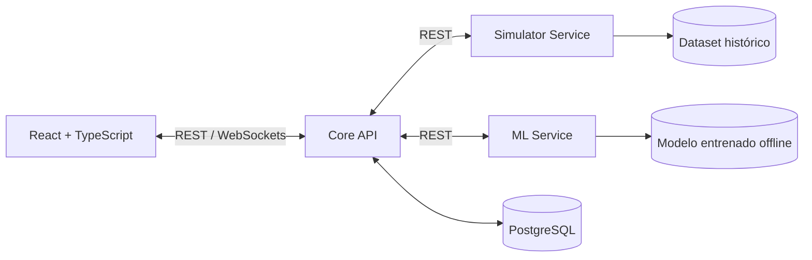

# FraudWatch — Arquitectura

Este documento reúne las decisiones de arquitectura del [plan del proyecto](./plan.md).

## Arquitectura confirmada

- **Frontend:** React + TypeScript + Tailwind CSS.
- **Backend:** **3 microservicios** (no monolito) comunicándose **mediante APIs REST**:
  1. **Simulator Service:** reproducción de operaciones históricas, estado de ejecución y controles iniciar/pausar/reiniciar.
  2. **ML Service:** carga del modelo offline, predicciones y explicaciones SHAP para alertas.
  3. **Core API:** usuarios y permisos, transacciones, alertas, reservas, decisiones, métricas y WebSocket hacia el frontend.
- **Base de datos:** PostgreSQL.
- **Tiempo real:** WebSockets para las actualizaciones de la interfaz; **REST para llamadas entre microservicios**.
- **Orquestación local:** Docker Compose; **sin despliegue en internet**.
- **Código fuente:** un **monorepo** con todos los componentes.
- **Pruebas:** unitarias y de integración; pruebas E2E completas no incluidas por ahora.
- **Documentación API:** OpenAPI y Swagger UI generados por FastAPI.
- **Observabilidad:** decisión **aplazada** a petición del usuario; no comprometer Prometheus, Grafana ni sistema avanzado de logs.
- **Migraciones PostgreSQL:** **pendiente** (pregunta 69 sin responder: scripts SQL o Alembic).

## Diagrama conceptual



> Diagrama lógico, no implementación final: decidir cuál servicio inicia cada llamada y cómo se publica cada evento antes de programar. Mantener un solo origen de verdad para los estados persistidos y emisiones WebSocket.

## Posible estructura del monorepo (propuesta, no decisión cerrada)

```text
fraudwatch/
├── frontend/                 # React + TypeScript + Tailwind
├── services/
│   ├── core-api/             # Usuarios, alertas, decisiones, WebSockets
│   ├── simulator/            # Reproductor histórico
│   └── ml-service/           # Inferencia y SHAP
├── ml/
│   └── training/             # Notebooks/scripts de entrenamiento offline
├── data/                     # Datos permitidos o instrucciones de descarga
├── tests/                    # Pruebas de integración entre componentes
├── docs/                     # Arquitectura y decisiones
├── docker-compose.yml
├── .env.example
└── README.md
```
